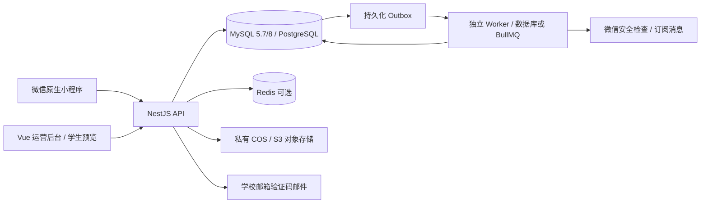

# 架构与实现约定

## 当前部署单元

采用模块化单体，保留清晰的模块职责和独立 Worker。无需在首期承担分布式服务的额外运维成本，数据库事务可以可靠连接审核状态与通知事件。

微信云托管复用原服务的 MySQL 与 COS，任务使用数据库原子领取；本地默认 PostgreSQL，Docker Compose 保留 PostgreSQL/Redis/S3 模式。无 Redis 时请求限流按实例计数，多个实例的总额度会增大；初期最多两个实例，后续需要严格共享额度时启用 Redis。

## 数据与身份

- School / Campus 描述学校与校区；Membership 是用户与学校的认证关系，默认认证有效期 180 天。
- 微信 OpenID 只在服务端处理。JWT 使用签发方、接收方和 7 天有效期，数据库 sessionVersion 让注销、退出、封禁即时撤销旧会话。
- 后端按学校校验每次操作，前端隐藏按钮不能代替权限检查。游客只可看非匿名内容摘要；认证用户可查看所属学校完整内容。
- STUDENT、SCHOOL_ADMIN、PLATFORM_ADMIN 分离。校级角色具有学校范围；全局封禁、身份追溯、任务和全局审计需要平台管理员。首版后台默认通过平台管理员密码登录，校级角色的独立后台登录/授权界面留待多人运营时扩展。
- 六类内容共用 Post 生命周期，二手价格按整数分保存；出售与求购有独立类型，失物记录丢失/拾到及日期地点。

## 内容与审核

DRAFT → PENDING → PUBLISHED / REJECTED；举报可使内容进入 HIDDEN；作者删除进入 DELETED。编辑增加版本并重新进入待审。

审核更新锁定记录并检查版本，防止旧审核覆盖新内容。已删除内容与其延迟安全检查不能重新发布。发帖使用客户端请求键和内容摘要，重试相同请求返回同一帖子；请求键用于其他内容会被拒绝。

树洞采用服务端 HMAC 生成帖内稳定别名。同一用户跨帖使用不同别名；帖子、评论、互动通知和普通审核列表不返回匿名用户标识。平台身份追溯必须填写原因并记入审计。它是社区展示层匿名，不是向平台完全匿名。

所有图文及评论均保留人工最终审核。微信文字检查是辅助信号；微信图片自动检查尚未接入，不能把本地演示视为平台完整内容安全验证。

## 消息可靠性

业务状态和 Outbox 事件在同一数据库事务中提交。Worker 原子认领事件，使用五分钟租约、退避重试和最多五次失败处理；管理员可重试失败事件。

站内 Notification 的 eventId 唯一，任务重放不会生成重复通知。微信一次订阅授权以行锁消费，发送记录和后续事件一起提交。网络超时或发送过程中崩溃会留下 UNKNOWN；保留站内消息且不自动重复外发。外部微信接口无法和本地数据库建立同一事务，因此不承诺端到端“恰好一次”外发。

## 媒体与保留期

图片随机存储键、5 MB 限制与基础文件签名校验。上传、认证材料和未公开内容使用私有权限，接口检查用户及学校后才提供图片；生产使用私有 S3，短期签名链接有效 60 秒。

Worker 每小时执行清理：未被帖子/认证引用的上传超过 24 小时清理；人工审核材料从处理时间起默认保留 7 天，到期删文件并清除引用，待审材料保留。VERIFICATION_RETENTION_DAYS 可调整；过期邮件验证码失效，超过材料保留期的已处理认证邮箱清除。认证状态记录仍保留。

账号注销隐藏公开内容、撤销认证并清除认证字段，属于软删除。审计、历史内容、举报证据及备份的最终保留和删除周期需要按实际运营政策进一步定稿。

## 首期性能边界

最新列表采用时间和 ID 游标，每页 20 条。热门算法按近 7 天最多 100 条排序并展示 20 条，基础搜索使用数据库字符串匹配。后台列表和消息最多返回 100 条，首期适用于试运营；大规模运营前应加后台分页、索引/搜索评估、热榜缓存及负载测试。

Redis 提供多实例限流；生产 API 与 Worker 分离，数据库备份和对象存储生命周期在部署侧管理。以后有明确流量或团队边界，再拆分热点模块。
