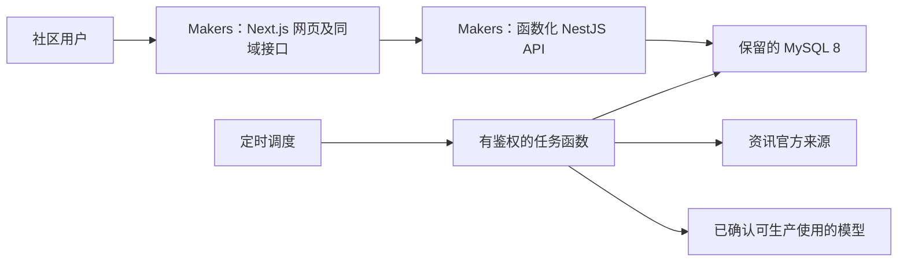

# Umeet 部署到 EdgeOne Makers 的可行性

后续决定：主站改迁阿里云 ECS，用户将另选新 MySQL；本报告保留作为 Makers 能力研究，原腾讯数据库复用建议不再是当前执行方案。参见 `rebuild/docs/operations/alicloud-deployment.md`。

核验日期：2026-11-15。用户已确认：微信云托管应用已停止，原 MySQL 仍保留并运行。

结论：可以作为迁移目标，优先复用现有 MySQL；需要把容器中的服务入口与常驻后台任务适配为 Makers 函数。当前不能承诺原样导入即可完整上线，也不能把免费模型额度当作生产预测能力。

本次只进行了本地代码、公开文档与公开 API 的只读检查，没有创建项目、部署、改域名、调整数据库访问权限或调用模型。没有修改应用代码。

## 一、核验依据与账户边界

采用用户指定的 `tencent-edgeone-skill`，已读取技能、API 调用和 API discovery 文档。

- `tccli` 工具检查失败，本机也未发现 Python tccli 模块，因此没有读取腾讯云账户中的套餐、Makers 项目或 MySQL 网络配置。
- 调用官方 API discovery 文档接口，HTTP 200；`teo` 的常规边缘函数 API 不等同于 Makers 的 Cloud Functions 项目部署接口。
- 通过 GitHub REST API 读取 `TencentEdgeOne/mysql-template` 的公开 `package.json`，HTTP 200；其使用 Next.js 和 `mysql2`，与官方文档的三方 MySQL 示例一致。这证明有此接入模式，不等于已经验证 Umeet 的生产数据库可以连接。
- 公开 MySQL 模板源码：[官方模板](https://github.com/TencentEdgeOne/mysql-template)。

## 二、与现有项目的对应关系

| 部分 | 当前实现 | 迁移判断 |
|---|---|---|
| Web | Next.js 16.4.5、App Router、SSR/Route Handlers | 平台支持这一框架大版本，具体补丁及依赖仍需部署验证 |
| API | NestJS 11，底层 Express，当前监听端口 | 可以评估导出 Express 应用的函数适配方式，保留业务服务，不必直接重写所有 API |
| 数据库 | Kysely MysqlDialect + mysql2，MySQL 8 | 优先保留；先验证 Makers 执行地域到数据库的网络路径、延迟及连接限制 |
| 登录及五账号切换 | Next 服务端 Cookie 与 API 代理、数据库会话 | 可保留原架构；需要配置新的服务地址和站点 Origin，不能直接指向已停止的旧 API |
| 资讯及每日预测 | `InterestRuntime` 进程启动后每分钟检查；来源租约十五分钟 | 改为调度触发的短任务，不能依赖实例始终在线 |
| Wiki 通知和任务队列 | `KnowledgeRuntime` / `JobsRuntime` 后台循环 | 同样需要函数化执行及可靠触发；仅迁预测循环还不够 |
| 图片 | `demo_assets` 表保存数据，API 提供访问 | 迁移初期可继续使用 MySQL；需控制请求体积，后续按需求评估对象存储 |
| CI/CD | `.github/workflows/ci.yml` 的 main 推送仍触发微信发布 | 迁移时需要替换或停用旧发布阶段，避免新提交再次发布已停用环境 |

官方 Next.js 文档列出支持 Next.js 13.5+、14、15、16、SSR、App Router 和 Route Handlers；同时明确 Next 内置 redirects/rewrites 应移至 `edgeone.json`。[框架说明](https://pages.edgeone.ai/zh/document/framework-nextjs)

官方 Node.js 文档支持 Express/Koa 框架应用，要求导出框架实例，不启动监听端口；提供第三方 MySQL 示例。Nest 的 Express 适配是依据这些能力及现有代码作出的工程推断，尚未通过 Makers 实际部署验证。[Node.js 函数](https://pages.edgeone.ai/zh/document/node-functions)

本地 Web standalone 产物约 32 MiB、API 编译代码约 0.8 MiB。两者都不是 Makers 最终单函数包大小；需要将依赖、原生模块和平台适配产物一起测量，不能据此宣称已符合部署限额。

## 三、建议的部署结构

这是一个可验证的迁移方向，暂未部署。若函数化验证无法满足后台任务的时效要求，可保留常驻 API/Worker 作为替代方案；是否有可用的既有服务器及成本尚未确认。

不建议只迁网页后继续调用已经停止的微信 API：网页即使发布成功，登录、发帖、Wiki、消息仍会失败。

### 数据库继续使用 MySQL

用户已保留 MySQL，因此不建议仅为更换托管平台而立即改用 PostgreSQL。代码不仅使用 SQL 抽象，还包含 MySQL 特定迁移类型、更新语句和锁；不是替换连接字符串就能完成的迁移。

若现有地址只能从微信云托管内网访问，Makers 不能自然继承这条内网连接，需要先确认可用网络接入方案。不要将浏览器直接连接数据库，也不要把数据库凭据放进客户端环境变量。当前尚未测试生产数据库连通性。

Makers 免费版文档提到 PostgreSQL，近期公告又提到数据库内测。不能把它理解为当前账号已经拥有一个可用且兼容 MySQL 的免费数据库；能力与开通情况需要账户级核验。[免费版说明](https://pages.edgeone.ai/zh/document/billing-free-plan)、[近期商业化公告](https://cloud.tencent.com/announce/detail/2541)

## 四、自动资讯和预测需要单独处理

Makers 的 Cloud Functions 是请求级执行单元。Umeet 现有 `setTimeout` / Worker 轮询不能作为生产定时服务继续运行；改为短任务，保留数据库的业务日唯一键、租约、配额和幂等逻辑。[函数说明](https://pages.edgeone.ai/document/agents)

目前 `edgeone.json` 已有 `schedules`，可配置时区 `Asia/Shanghai`，每天 08:00 的预测可以作为候选用途。但官方文档明确写出 cron 最小间隔一天，同时也列出了每小时表达式示例，两处表述需要实测或由平台确认；在确认前不能承诺每十五分钟定时采集可用。[调度配置](https://pages.edgeone.ai/zh/document/edgeone-json)

因此：

- 每日预测：评估平台每天一次的调度，核验触发鉴权、失败重试和时区；运行不足或无模型时继续明确暂停。
- 资讯采集、Wiki 通知、队列重试：需要更高频的外部触发，或调整到经用户接受的刷新策略，不能只删除循环而不补执行机制。
- 任务函数需要拆分小批次。当前来源检查最多十个候选，网络调用和模型调用累加后可能超过函数上限，应分别领取和续执行，避免完整任务挤进一个请求。
- 数据库迁移应作为受控发布步骤，不能在每次函数冷启动时执行现在的建库/迁移入口。

## 五、免费额度的实际边界

按当前套餐文档，免费版的主要限制包括：每月构建 300 分钟；Cloud Functions 每月 100 万次调用、5 万 GB-s 内存时长、5 GB 数据传输；单次执行最长 120 秒、单函数包含依赖 128 MB、请求/响应体 6 MB。免费额度耗尽会限制相应功能，不承诺 SLA。专业版则可能发生超量后付费。[套餐对比](https://pages.edgeone.ai/zh/document/billing-plan-comparison)

免费的是对应 Makers 套餐额度，不代表原 MySQL、域名、外部调度、邮件短信或模型调用都免费。原数据库目前的套餐和账单未读取。

项目有两点需要优先调整：

1. 现有 API 允许 8 MB JSON，而平台请求/响应上限为 6 MB。图片以 data URL 上传，编码后体积进一步增大，需要降低请求限制或改为单独上传。
2. 当前私信在前台页面每 12 秒刷新，在收件箱每 4 秒刷新。按一个登录用户每天前台停留一小时、每月三十天估算，仅 12 秒轮询就约 9000 次逻辑请求；一百人即约 90 万次，尚未计页面与其他接口。若 Next 代理和 Nest API 分属两次函数执行，还需计入额外调用。最终额度消耗要以平台观测为准。

构建环境可以选择 Node 24，但 Cloud Functions 文档仍标明默认运行时 Node 20。Umeet 明确要求 Node 24，必须分别核验构建和运行时版本，不能因构建成功就认定运行兼容。[构建环境](https://pages.edgeone.ai/zh/document/build-guide)、[函数运行时](https://pages.edgeone.ai/zh/document/cloud-functions)

## 六、内置模型不等于生产预测服务

官方 Makers Models 文档说明内置模型用于初创技术验证，明确不应用于生产环境。因此现阶段可以考虑隔离的技术验证，但不能直接把赠送 Token 接到公开社区每日预测并宣称满足生产零付费要求。[模型使用条件](https://pages.edgeone.ai/zh/document/models-vendors-overview)

维持此前策略：没有确认可正式使用、无自动计费回退的模型，就显示预测暂停；社区、Wiki、资讯和投票可以独立运行。

## 七、域名与访问范围

用户希望同时服务境内外。应验证自有域名方案，而不是把临时默认域名当作正式入口。官方说明默认项目/部署域名在大陆访问存在预览鉴权限制；使用中国大陆或含大陆加速区域时，自定义域名要求备案。全球不含大陆区域的自定义域名不要求平台所述备案，但不等于承诺大陆访问性能。[域名说明](https://pages.edgeone.ai/zh/document/domain-overview)、[项目错误码及默认域名访问规则](https://pages.edgeone.ai/zh/document/error-codes)

## 八、建议执行顺序

1. 核验 MySQL 到 Makers 的连接方案、运行时版本、账户免费套餐和自有域名条件。
2. 独立预览项目验证 Next.js 与 Nest 函数适配；复用测试数据库或脱敏副本，避免测试写入正式社区。
3. 跑通登录与五账号切换、发帖、Wiki、消息、投票、资讯/预测读取、图片上传及权限校验，观测冷启动、连接池和调用消耗。
4. 补齐每日预测、资讯、Wiki 通知和队列的触发机制；没有可用生产模型时保持预测暂停。
5. 更新原微信 CI/CD 发布阶段，通过后再切换正式域名和生产连接。创建项目、配置访问权限及正式部署属于后续写操作，本次未执行。

当前建议：可以采用 Makers 做迁移验证，并优先评估“Next.js + 函数化 Nest API + 原 MySQL”。在数据库连通、调度频率和运行时三个关键条件验证前，不把它当作已经准备好的完整生产替代方案。
