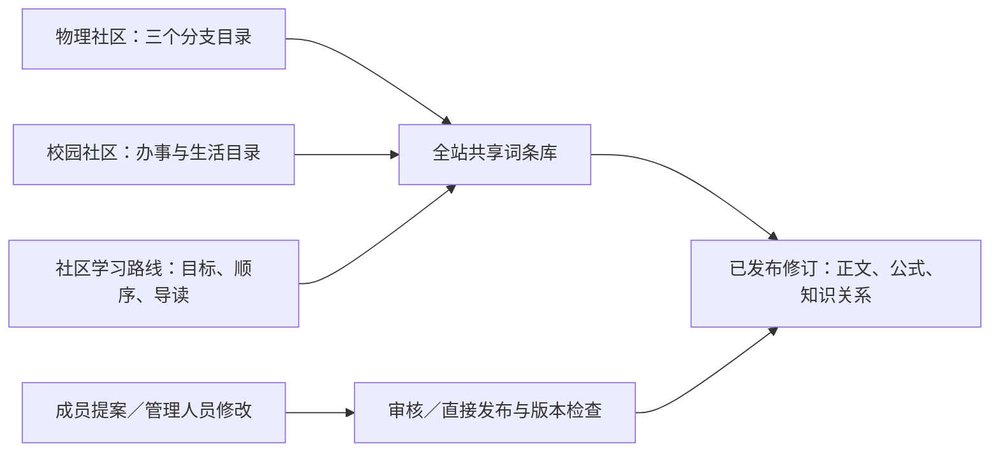

# Umeet 新 Wiki：共享知识库设计方案

日期：2026-11-12。状态：需求访谈 Q1–Q30 已确认一致；已完成本地实现与隔离环境验收，未部署线上。结果见 [实施与验收记录](../../../rebuild/docs/knowledge-acceptance.md)。

## 1. 目标与产品边界

建立社区共同维护、长期可查的共享知识库，同时支持：

- 快速查阅：校园指导手册、办理步骤、问题解答。
- 系统学习：学科概念、理论近似、实际应用，以及有目标、有顺序的学习路线。

新 Wiki 独立建设，旧内容由人工搬运。本方案不要求自动迁移旧正文、版本或旧链接。旧数据暂留作搬运来源，不因建设新 Wiki 自动删除。

完整能力一起开放，不拆成对用户分阶段上线。内部按依赖顺序开发、集成和测试；开放前必须完成两类真实内容样例及跨社区协作验收。

## 2. 已确认决策总表

| 决策 | 确认结果 |
| --- | --- |
| Q1–Q3 定位 | 社区共建；查阅和学习并重；跨社区共享一份正文 |
| Q4、Q8 正文治理 | 不设专属维护团队；任何社区中拥有有效 Wiki 管理权限的人员均可治理全站正文，不要求该社区收录该词条 |
| Q5、Q16 修改发布 | 普通成员修改先审核；Wiki 管理人员可直接发布；正文、知识关系和条件说明一起审核、一起版本化 |
| Q6、Q10 目录 | 同一词条可被多个目录收录并独立排序；目录和路线由本社区具有 Wiki 管理权限的人员维护，普通成员提建议 |
| Q7 粒度 | 一个可独立解释的概念或完整任务为一篇词条，课程由目录与路线组织 |
| Q9 并发 | 旧版本稿件必须核对最新差异，再确认发布，不能覆盖他人修改 |
| Q11 分类 | 每个社区自定义目录；基础理论／近似理论／实际应用是物理社区的组织方案，不是全站强制分类 |
| Q12 编辑 | 统一正文编辑器＋普通词条／指导手册／学科知识等可选模板，结构可调整 |
| Q13、Q23 关系 | 固定前置知识、近似自、应用于、相关知识四种，附可选条件、解释和依据；首版不开放社区自定义关系类型 |
| Q14 路线 | 学习路线独立于目录，能选择共享词条、安排顺序、填写总目标和分步导读 |
| Q15 存续 | 词条独立存在于全站库；取消所有社区收录也不删除正文 |
| Q17、Q24 争议 | Wiki 管理人员可提争议；全站管理员决定暂停／恢复直接发布并组织复核；标记不自动冻结；暂停期间保留发布版并接收建议 |
| Q18 删除 | 默认可恢复隐藏，历史与引用状态保留；永久清除仅全站管理员 |
| Q19 路线更新 | 跟随最新已审核正文，正文更新后提醒路线维护者复核 |
| Q20 同名与改名 | 同名异义分开建词条，名称加限定；保留别名与重命名后的旧链接 |
| Q21 手册时效 | 只展示最后编辑时间；不增加最近核实、到期复核或到期自动下架机制 |
| Q22、Q25 开放 | 完整能力一起开放；两类真实样例与共享收录、审核、并发、争议、隐藏恢复全部验收 |
| Q26 旧内容 | 全新建设，旧内容人工搬运 |
| Q27 阅读 | 已发布内容可匿名阅读，登录成员才能贡献；草稿与待审版本不进入公开搜索 |
| Q28 待审可见性 | 仅作者及有审核权限的人员可见，退回给原因，可修改后重提 |
| Q29 草稿 | 私人草稿自动保存，可跨刷新、重新登录恢复；失败明确提示 |
| Q30 | 用户已确认上述核心方向一致，授权整理正式搭建方案 |

## 3. 信息结构

目录回答“去哪里找”，路线回答“按什么顺序学”，共享词条承载实际内容。目录与路线只引用词条，正文修改统一进入版本与发布流程。

| 对象 | 职责 | 关键边界 |
| --- | --- | --- |
| 共享词条 | 一份概念或任务正文，拥有稳定身份、已发布版本、历史、别名、状态 | 不绑定唯一所属社区；模板不决定权限 |
| 社区收录 | 表示某社区收录某篇共享词条 | 收录不复制正文；取消收录不删除词条 |
| 目录节点 | 社区自己的多层知识分类，可排序 | 与文章内部章节目录不同；不能循环挂载 |
| 目录条目 | 将共享词条放进某个目录，并设置本目录下的顺序 | 同一词条可出现在多个目录 |
| 词条修订 | 正文、结构化关系、解释、条件与来源的一份不可变快照 | 修改公开内容必须生成新修订 |
| 修改提案 | 针对基准修订的候选修改及审核过程 | 与私人草稿分开，不覆盖公开正文 |
| 私人草稿 | 作者的未提交编辑内容，含标题、模板、正文、关系、修改说明及基准修订 | 仅作者可读写；不进入搜索、反链、目录或管理公共列表 |
| 知识关系 | 词条之间含有语义的关联 | 绑定来源修订，不能通过独立接口绕过审核改动 |
| 学习路线 | 社区维护的一组有顺序的词条引用、总目标与分步导读 | 不复制正文；与目录独立存在 |
| 路线复核状态 | 记录每个步骤维护者上次确认的词条修订 | 词条更新后提示待复核，不回退到旧正文 |
| 争议与管理事件 | 争议依据、暂停／恢复决定、隐藏恢复及审核记录 | 管理记录不能代替内容依据；权限和内容正确性分开 |

### 理论关系的统一语义

| 类型 | 表达方向 | 附加说明 |
| --- | --- | --- |
| 前置知识 | A → B：理解 A 通常需要先了解 B | 解释为什么需要 B，避免被误解为所有读者都必须按此学习 |
| 近似自 | A → B：A 在一定假设和条件下由 B 近似得到 | 可填近似条件、忽略项、适用域、误差或失效说明、依据 |
| 应用于 | A → B：理论或模型 A 可用于应用／问题 B | 说明所用模型、条件及用途；反向展示“采用的理论” |
| 相关知识 | A ↔ B：没有更明确关系类型的相关内容 | 展示关联理由，避免与普通正文引用混同 |

正文链接、反向链接和知识关系分别呈现：引用一篇文章不自动意味着先修、近似或应用关系。

## 4. 编辑与阅读体验

### 4.1 简单指导手册

校园卡补办、选课等可使用指导手册模板：适用对象、准备材料、步骤、注意事项、来源。模板是可调整的起点，不强制填入理论、近似等学科信息。手册显示最后编辑时间，读者可提交纠错。

页面不把“最后编辑时间”改称“最后核实时间”。不建立到期复核任务，不按时间自动下架。

### 4.2 学科知识

学科模板可引导填写概念、假设、公式、推导、适用条件、例子和参考资料。支持公式、图片、表格、代码、普通链接与词条引用。结构化关系通过选择具体词条建立，不依赖作者手写内部 ID。

物理社区示例目录：基础理论、近似理论、实际应用。它们可进一步分层，也可与力学、光学等主题目录共同收录同一篇词条。基础理论仍可说明适用范围，不承诺任何理论在所有条件下成立。

### 4.3 全站与社区入口

- 全站 Wiki：搜索已发布词条、查看摘要与主题限定、进入词条。
- 社区 Wiki：本社区目录、收录词条、学习路线。
- 词条页：正文目录、已发布正文、知识关系、引用／反链、历史、讨论与纠错入口。
- 路线页：目标、步骤、各步导读、当前词条状态、待复核标记。
- 管理页：全站候选版本审核与争议队列；社区目录与路线建议分别按所属社区处理。

同名词条采用“名称（限定）”呈现。搜索结果提供摘要和主题线索。链接以稳定词条身份绑定；新 Wiki 内改名保留旧名称映射。含糊别名应显示候选供用户选择，不能默默绑定第一条结果。旧 Wiki 的历史链接不在自动兼容承诺内。

## 5. 协作与状态流

### 普通成员

私人草稿 → 提交候选版本 → 待审核 → 批准发布／退回补充。

退回保留原因与候选内容，作者可修改重提。提交和审核操作需支持幂等；候选稿的基准修订失效时，进入差异核对流程。公开正文在审核通过前保持原样。

### Wiki 管理人员

可直接发布全站正文修改，也可处理普通成员提案；每次发布仍生成版本、保留操作者与修改说明，并检查基准修订。权限不因为词条没有被其社区收录而受限。

暂停直接发布的词条上，普通发布捷径失效；可继续提交修改建议，复核发布由全站管理员控制并留依据。争议标记与冻结状态是不同字段和不同操作。

### 隐藏与恢复

隐藏后公共正文、公开搜索和正文预览不可再泄露内容；引用处显示不可用提示。已知词条链接可显示状态说明，不展示被隐藏正文。恢复后引用恢复可访问。默认保留历史，公共历史仍应遵守隐藏／敏感修订权限。

永久清除仅全站管理员可执行，执行前明确展示影响对象及不可恢复性；引用端保留不含正文的不可用标识或等效提示，避免把 ID 重新指给其他内容。

### 私人草稿

自动保存到服务端，按账号、词条和编辑任务隔离，恢复标题、正文、关系、模板和基准修订。提供保存中／已保存／保存失败状态与重试，退出再登录或换设备可恢复已保存内容。自动保存使用草稿版本检查，多个设备不能静默互相覆盖；未成功保存的数据不能宣称已保住。提交成功后清理或归档对应草稿，失败保留内容。

## 6. 权限矩阵

| 操作 | 游客 | 登录普通成员 | 任一社区的有效 Wiki 管理人员 | 全站管理员 |
| --- | --- | --- | --- | --- |
| 阅读／搜索公开发布版 | 是 | 是 | 是 | 是 |
| 私人草稿 | 否 | 仅自己 | 仅自己 | 仅自己；管理身份不自动读取他人私人草稿 |
| 创建／提交正文提案 | 否 | 是 | 是 | 是 |
| 查看待审版本 | 否 | 仅自己的 | 全站可审核范围 | 全站 |
| 审核／直接发布共享正文 | 否 | 否 | 是，全站范围 | 是 |
| 修改目录／路线 | 否 | 提建议 | 限其获授权社区 | 全站 |
| 提出争议 | 否 | 使用纠错或举报反馈 | 是 | 是 |
| 暂停／恢复直接发布、主持争议复核 | 否 | 否 | 否 | 是 |
| 隐藏／恢复词条 | 否 | 否 | 是，全站范围 | 是 |
| 永久清除 | 否 | 否 | 否 | 是 |

实现时需以当前有效授权计算 Wiki 管理资格，考虑撤权和团队暂停。不能仅因某人是版主就忽略其 Wiki 权限，也不能把“全站正文治理权”扩展成站点设置或人员管理权。

## 7. 当前项目事实与技术建议

以下为实现建议，不是新增的用户需求：

- 沿用现有 Next.js／React、NestJS、MySQL、TypeScript，不为首版另引入图数据库。
- 建立新知识库模块和独立数据表，不再把新系统正文存为 demo 快照。
- 复用独立 Wiki 的编辑器、Markdown／KaTeX、安全校验、差异、幂等及反链代码；复用社区入口和管理界面习惯。复用组件不等于自动复用其旧权限或单社区归属假设。
- 新试运行入口建议 `/knowledge`，社区入口 `/c/[slug]/knowledge`。完整验收后统一主导航到新入口；建设中保留原 `#/wiki` 与 `/wiki` 数据来源，旧入口下线另作明确操作。
- 目录、关系、路线采用关系表；已发布指针、不可变修订和候选稿分开。搜索与列表分页，避免把全站正文一次性加载到客户端。
- 私人草稿服务端存储；本地缓存仅辅助故障恢复，不作为跨设备恢复依据。
- “前置知识”默认阻止自引用和循环；其他关系不套用学习先修的无环限制。目录移动防环，路线不强行自动加入所有先修内容。
- 路线复核使用“已确认修订 ID 与当前发布修订 ID 是否一致”判断；结合持久化提醒，避免服务中断导致永远漏报。
- 新 Wiki 单独定义全局正文与社区组织两种权限判断，保留旧 Wiki 的权限边界，避免两套路由互相绕过。

只读代码核对依据：

- 当前社区入口：`rebuild/apps/web/src/components/community/Wiki.tsx`、`content.tsx`；其数据为 `demo_entities` 的结构化 Wiki JSON。
- 另一套入口：`rebuild/apps/web/src/components/wiki/`、`rebuild/apps/api/src/modules/wiki/`；数据为 `wiki_pages/wiki_revisions/wiki_links`，每页绑定单社区。
- 两套均没有可直接复用的完整候选版本审核、跨词条目录、学习路线或类型化知识关系系统。现有发布后巡查不等于发布前审核。

## 8. 开放前验收

| 场景 | 必须证明 |
| --- | --- |
| 物理知识 | 三个分支可自建、分层、排序；词条复用；公式正确渲染；四类关系可维护且条件明确；可完成一条含目标和导读的学习路线 |
| 校园手册 | 普通作者能用简单模板完成步骤指南，无需填写学科字段；能搜索、按目录阅读和纠错；只展示最后编辑时间 |
| 跨社区共享 | 两社区收录同一正文，各自组织目录；另一未收录社区的有效 Wiki 管理人员可审核正文；取消最后一个收录不删正文 |
| 审核与可见性 | 普通成员不能直改公开正文；待审内容仅作者及审核人员可见；退回重提；公开搜索、反链和预览不泄露草稿 |
| 并发 | 两作者、两审核者基于同一版本操作时不能静默覆盖或重复发布；差异核对后才能发布 |
| 草稿 | 刷新、重新登录、另一设备恢复；断网及失败提示；不同账号与不同编辑任务隔离；多设备冲突不丢稿 |
| 争议 | 提争议不自动冻结；只有全站管理员可暂停／恢复；暂停期间仍可提建议，公开版保持可读 |
| 隐藏与永久清除 | 隐藏恢复可逆；目录、路线、反链及缓存状态一致；非全站管理员不能永久清除 |
| 路线更新 | 词条发布新版本后路线显示最新正文，并提醒维护者复核；确认旧版本不能错误清除新版本的待复核状态 |
| 别名与同名 | 语义不同的同名词条能明确区分；新 Wiki 改名不使既有引用失效；含糊别名不误跳 |
| 权限与交互 | 撤权后旧页面请求也被拒绝；目录与路线跨社区修改被拒绝；手机、键盘、未保存离开与错误恢复可用 |

样例必须包含真实可核对内容，不能仅以占位文字和模拟接口证明知识场景成立；样例规模以覆盖上述关系和协作为准，不把“导入整个物理学体系”作为开放前置条件。

## 9. 首版范围收口

首版包含本文件全部主流程。个人学习进度、练习考试、AI 生成内容、自由定义关系类型、全局大图谱可视化未在访谈中确认，不能以“知识系统完整”为由自动加入。最后编辑时间不提供内容已核实的保证；学习路线也不意味着平台已审定一套理论的科学正确性。

## 10. 实施交接

配套计划：`docs/superpowers/plans/2026-11-12-wiki-knowledge-system.md`。内部任务可以逐个开发，正式开放是单一验收关口。本地已实现并接入新入口，旧内容保留供人工整理；线上迁移、部署与公开流量切换尚未执行。
