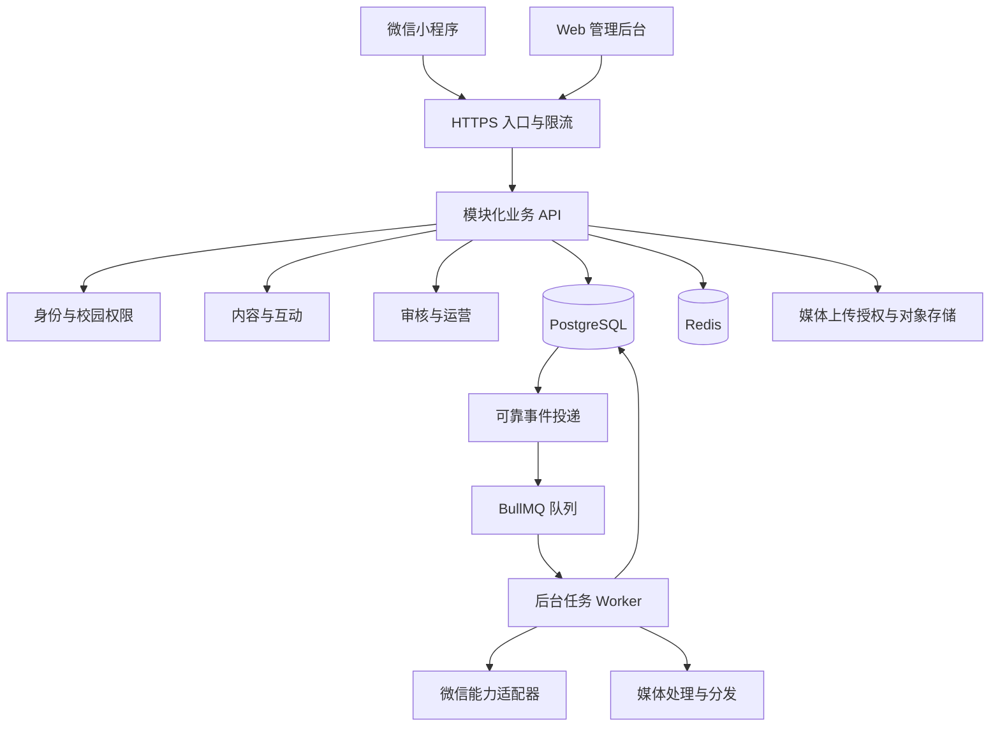

# 学生社区微信小程序：需求与架构分析报告

版本：v0.1，供讨论与修改  
日期：2026年10月11日  
分析依据：指定的 Beita 前端、后端仓库源码，以及框架官方文档。

## 1. 建议结论

建议把产品定位为：**以学生身份为信任基础，围绕同校交流、生活互助和闲置流转建立的校园社区。**

首版以“浏览内容 → 完成校园认证 → 发布或参与 → 得到回复 → 标记事情已解决”为主要闭环。建议包含校园广场、求助问答、失物招领、二手信息、受控匿名交流、消息中心和个人中心，并同步建设可用的运营管理后台。

技术上建议采用：**微信原生小程序 TypeScript + 独立 Web 管理后台 + NestJS 模块化单体后端 + PostgreSQL + Redis + 对象存储 + 异步任务 Worker。**

这里的“先进”体现为明确的业务边界、可信的身份鉴权、可靠的审核与消息流程、可维护的数据模型和可演进的部署方式。首版采用一个主要业务后端，后台任务可独立运行；微服务、复杂推荐算法和 Kubernetes 等能力，根据实际需求再引入。

本报告中的功能优先级和技术选择都是建议，尚未视为你的最终决定。

## 2. 分析范围与暂定前提

为使建议具体，暂按以下情况设计：

- 面向高校学生，先在一所学校或少量校区试运营。
- 由小团队开发和维护，希望后续扩展到多校。
- 首个客户端是微信小程序，多端需求尚未确定。
- 首版二手模块提供信息发布和沟通，不代收货款、不做交易担保。
- 暂不接入学校教务系统，也不要求用户提供学校账号密码。

若目标是全国多校同步上线、中小学生社区、学校官方平台，或者首版就做交易支付，需要调整身份、权限、治理和交付范围。

本次检查了前端页面配置、首页与发布逻辑、云函数，以及后端依赖、控制器、实体和数据库建表定义；没有部署运行这两个项目，因此“源码中存在”不等于“线上可用”。两份 README 都注明有 AI 生成内容，功能判断优先依据代码。

源码快照：

| 仓库 | 本次检查的提交 | 提交日期 |
|---|---|---|
| Beita-frontend | `52d4c8f85264a8f7caf3aebe31d9c2cd5ebc6a16` | 2025-07-19 |
| Beita-backend | `8a9dc165145226723427ec8ab0ce505bb6c142fb` | 2025-08-14 |

## 3. 参考项目提供了哪些产品启发

### 3.1 可以保留的思路

| 观察到的功能 | 对新产品的启发 |
|---|---|
| 首页包含二手、失物、求助、兼职、租房、情感等分类 | 校园内容需要按使用场景组织，避免所有信息混在一起 |
| 按校区筛选 | 学生更关心身边的信息，应把学校、校区作为基础维度 |
| 独立树洞入口 | 公开交流和匿名表达的使用动机不同，需要明确身份展示规则 |
| 校园认证、个人发布及评论记录 | 认证负责建立信任，个人中心负责管理参与记录 |
| 评论、点赞、搜索、热门内容 | 社区需要从发现到互动的基础能力 |
| 文字与图片审核云函数 | 用户生成内容必须有审核流程 |

以上来自实际页面配置及首页逻辑，可参阅[前端页面配置](https://github.com/Tecitomous/Beita-frontend/blob/52d4c8f85264a8f7caf3aebe31d9c2cd5ebc6a16/miniprogram/app.json)、[首页分类代码](https://github.com/Tecitomous/Beita-frontend/blob/52d4c8f85264a8f7caf3aebe31d9c2cd5ebc6a16/miniprogram/pages/index/index.js)和[审核云函数目录](https://github.com/Tecitomous/Beita-frontend/tree/52d4c8f85264a8f7caf3aebe31d9c2cd5ebc6a16/cloudfunctions)。

后端还能找到约伴、报名和团购相关接口，但本次没有确认它们在所给前端中形成完整用户流程，宜作为扩展线索。参见[校园控制器](https://github.com/0C5A2Z8H/Beita-backend/blob/8a9dc165145226723427ec8ab0ce505bb6c142fb/src/main/java/com/example/demo/controller/XiaoyuanController.java)。

### 3.2 新项目需要重新设计的地方

1. **业务代码组织。** 校园控制器有两千余行，并通过 `region` 分支选择不同服务。新项目应按身份、帖子、互动、审核等业务模块组织，学校差异通过数据与配置表达，避免每增加学校就复制逻辑。
2. **身份与权限边界。** 发布请求传入 `openid`、用户名和计数等字段；登录接口把微信返回对象直接装入结果。新项目应由后端会话识别操作者，敏感会话信息留在服务端，作者、时间及计数由服务端决定。
3. **内容模型。** 原 `task` 表同时承载帖子、价格、微信号、校区和互动计数，价格、时间使用字符串。新项目应区分内容主体与二手、失物等扩展数据，采用明确的金额与时间类型。
4. **客户端和后端契约。** 接口命名、请求格式和状态含义需要统一；公开返回字段应按用途设计，匿名帖子尤其需要专用返回模型。

这些是静态代码观察，不构成完整安全审计。证据见[发布页面](https://github.com/Tecitomous/Beita-frontend/blob/52d4c8f85264a8f7caf3aebe31d9c2cd5ebc6a16/miniprogram/pages/addPost/addPost.js)、[登录控制器](https://github.com/0C5A2Z8H/Beita-backend/blob/8a9dc165145226723427ec8ab0ce505bb6c142fb/src/main/java/com/example/demo/controller/WXController.java)、[数据库建表文件](https://github.com/0C5A2Z8H/Beita-backend/blob/8a9dc165145226723427ec8ab0ce505bb6c142fb/beita.sql)。

后端使用 Spring Boot 2.5.10 和 Java 8，这是原项目的技术事实；新项目应选择开发时仍受支持且相互兼容的框架与运行时版本。参见[后端依赖配置](https://github.com/0C5A2Z8H/Beita-backend/blob/8a9dc165145226723427ec8ab0ce505bb6c142fb/pom.xml)。

## 4. 产品定位与用户角色

建议先建立“可信、有用、有人回应”的校园社区，优先服务四类行为：

- **找信息：** 找失物、闲置物品、校园经验和办事方法。
- **求帮助：** 提问、征集建议、寻找学习或运动伙伴。
- **作表达：** 分享日常、讨论校园生活、匿名倾诉。
- **参与活动：** 发现社团与学生组织活动，后续支持报名。

角色与权限建议如下：

| 角色 | 建议权限 |
|---|---|
| 游客 | 浏览允许公开的内容；看不到联系方式、认证材料和内部内容 |
| 已登录未认证用户 | 管理个人资料、申请认证、反馈问题；首版限制发帖和评论 |
| 已认证学生 | 发帖、评论、点赞、收藏、举报、标记事项完成 |
| 学校或板块管理员 | 处理授权范围内的内容、举报和运营配置 |
| 平台管理员 | 管理学校、管理员授权和全局治理；敏感操作留审计记录 |

认证应证明“与某学校有关联”，不默认向其他学生展示真实姓名和学号。毕业生是否保留权限、用户能否关联多所学校，需要单独制定规则。

## 5. 建议包含的功能与优先级

优先级定义：**P0 是试运营必须形成的闭环，P1 是验证需求后优先扩展，P2 是规模或商业模式明确后再做。**

| 模块 | 内容与关键规则 | 优先级 |
|---|---|---|
| 登录与校园身份 | 微信登录、学校/校区选择、认证申请、审核结果、认证失效或撤销 | P0 |
| 校园广场 | 图文帖子、分类、最新与热门、详情、基础搜索、分享 | P0 |
| 求助问答 | 问题说明、评论回答、作者标记已解决；后续支持采纳答案 | P0 / P1 |
| 失物招领 | 丢失/拾到类型、时间地点、物品描述、已找回状态 | P0 |
| 二手信息 | 出售/求购、金额、成色、校区、在售/已出/下架；沟通方式受控 | P0 |
| 匿名树洞 | 认证后匿名发帖、帖内固定身份、评论、举报、审核、匿名说明 | P0，启用需有审核人力 |
| 基础互动 | 评论与回复、点赞、收藏、删除本人内容、屏蔽用户 | P0 |
| 消息中心 | 评论/回复、认证与审核结果、系统通知、未读状态 | P0 |
| 个人中心 | 我的发布/评论/收藏、资料、认证、反馈、隐私与账号管理 | P0 |
| 运营后台 | 学校/校区、分类、认证审核、内容审核、举报处置、封禁、公告和审计 | P0 |
| 活动与约伴 | 活动详情、报名/退出、容量、截止时间、取消通知 | P1 |
| 圈子与关注 | 学习/运动/兴趣圈、成员与管理员、关注内容 | P1 |
| 站内私信 | 文本沟通、会话权限、陌生人限制、拉黑、消息审核 | P1；若二手为主业务可前移 |
| 校园指南 | 新生指南、办事流程、校园生活入口，由运营维护 | P1，可先用精选帖实现 |
| 兼职与租房 | 信息有效期、发布方核验、举报与处置机制 | P1 / P2 |
| 支付、跑腿、团购 | 订单、履约、退款、争议处理、对账及相应运营能力 | P2 |
| 个性化推荐与 AI | 可解释推荐、辅助分类/摘要、基于受控知识的校园问答 | P2 |

### 5.1 几个影响体验的产品规则

**二手与失物要有结束状态。** 只支持发布会累积过时信息。作者应能标记已出、已找回或已解决，并设置过期提醒或自动归档。

**点赞和收藏分开。** 点赞表示认可，收藏方便回看；它们的权限、通知和统计各自定义。

**联系方式默认不公开。** 首版可让发布者选择是否向同校认证用户提供联系方式，通过受控接口展示并限制查询频率。如果用户希望手机号或微信号不对陌生学生展示，就需要把受控站内沟通前移到首版。

**失物认领保留核验线索。** 不公开证件完整号码及全部细节，让认领者提供特征；避免把评论中“我领取了”当作认证认领结果。

**热门与最新并列。** 小社区初期先按校区、时间和分类提供内容。热门可使用近期互动与时间衰减，并抑制重复互动和违规内容，不必首版训练推荐模型。

**树洞需有独立规则。** 匿名身份建议只在同一帖子内稳定，不跨帖展示关联，也不链接个人主页。后台只向获授权人员提供必要的追溯能力。

## 6. 页面结构与关键流程

### 6.1 页面建议

建议底部使用四个固定入口：**社区、校园、消息、我的**，发布按钮放在主要内容页的明显位置。

| 入口 | 包含内容 |
|---|---|
| 社区 | 广场、分类、最新/热门、匿名板块、搜索与帖子详情 |
| 校园 | 二手、失物、求助和指南快捷入口；后续活动、约伴 |
| 消息 | 回复、系统通知、认证/审核结果；后续私信 |
| 我的 | 资料、认证、个人内容、收藏、屏蔽、反馈及账号设置 |

社区和校园可访问同一条内容：社区提供统一发现，校园提供按任务进入的路径，后端保留同一份数据。若首版内容较少，可先合并为“社区、消息、我的”三个入口。

页面规模暂估约 15–20 个页面，实际以原型为准。发布页按类别展示字段，保持统一的图片上传、草稿、校区选择和审核状态体验。

### 6.2 发帖闭环

```text
登录及认证校验 → 选择类别 → 编辑内容/上传图片 → 保存草稿或提交
→ 服务端校验与审核 → 发布或进入人工复核 → 互动回复
→ 作者标记已解决/已出/已找回 → 归档
```

提交成功先显示“已提交，审核中”，仅在公开状态确定后显示“发布成功”。审核服务超时保留待审状态并重试，避免未经审核直接公开。

### 6.3 校园认证

首选验证学校邮箱的控制权；邮箱域名只是辅助条件，还需要明确在读、毕业及有效期规则。无法使用学校邮箱时，提供人工审核方案，材料字段最小化，文件私有保存，并定义审核后的保留和删除策略。

微信登录本身不证明学生身份。学校统一身份认证只有在取得授权、接口及合作条件后才考虑接入。

### 6.4 举报处置

```text
用户举报 → 记录原因与内容版本 → 分派到对应学校/平台审核队列
→ 审核判定 → 维持、限流、隐藏、删除或限制账号
→ 通知处置结果 → 必要时申诉 → 保留授权审计记录
```

“删除”与“隐藏”要区分：前者可能由作者发起，后者通常是治理操作。申诉期间的证据访问需受权限控制。

## 7. 架构方案比较

| 方案 | 优点 | 代价与适用条件 | 本项目建议 |
|---|---|---|---|
| 云开发一体化 | 减少基础设施工作，登录、存储和函数接入较方便 | 需适配平台权限、数据及部署模型，迁移时有适配成本 | 一人开发、快速试验可选 |
| 模块化单体 + 托管基础设施 | 单库事务直接，模块边界可控，开发部署较简单 | 必须落实模块约束、后台任务和监控 | 默认推荐 |
| 微服务 | 可按业务独立部署和扩容，适合多团队分工 | 增加网络失败、数据一致性、服务治理和运维工作 | 出现明确组织/容量需求后再评估 |

云开发也可以承载模块化后端；“云开发”是平台与部署选择，“模块化单体”是业务组织选择，两者可以组合。CloudBase 官方文档目前列有关系型与文档型数据库、身份认证、云函数、存储及云托管，不能把它简单理解为只支持文档数据库。[CloudBase 官方文档](https://docs.cloudbase.net/)

### 7.1 推荐技术组合

| 层次 | 默认选择 | 原因与替代条件 |
|---|---|---|
| 微信小程序 | 原生小程序 + TypeScript + 组件化 | 当前只有微信端，平台行为直接；有明确多端计划或 React 团队时评估 Taro |
| 管理后台 | Vue 3 + TypeScript + 成熟后台组件库 | 表格、筛选、审核表单需求明确；若团队熟悉 React，可用 React |
| 业务后端 | NestJS + TypeScript | 与前端统一语言，使用模块、依赖注入和统一鉴权；Java 团队可选 Spring Boot + Spring Modulith |
| 主数据库 | PostgreSQL | 承载身份关系、内容、审核记录和事务；熟悉 MySQL 的团队可采用受支持版本 |
| 数据访问 | Prisma + 数据迁移 | 提高模型和常规查询开发效率，复杂查询保留受控 SQL |
| Redis | 缓存、频率限制、BullMQ 队列 | 不作为帖子、认证和通知的唯一持久存储 |
| 文件 | 对象存储 + CDN | 图文资源独立于应用磁盘，公开内容和私有材料分区管理 |
| 后台任务 | BullMQ + 同代码库 Worker | 处理审核、通知、清理与归档，支持重试和独立扩容 |
| 接口契约 | REST + OpenAPI | 统一文档、生成客户端类型，方便联调与兼容管理 |
| 部署 | 容器或云托管 + 托管数据库 | 首版减少运维负担，保留水平扩容能力 |

NestJS 提供模块封装、OpenAPI 生成和 BullMQ 集成，能支撑上述组织方式；业务边界和可靠性仍需要项目自行实现。[模块文档](https://docs.nestjs.com/modules)、[OpenAPI 文档](https://docs.nestjs.com/openapi/introduction)、[队列文档](https://docs.nestjs.com/techniques/queues)

若使用 Java，Spring Modulith 可以表达模块公开接口并验证模块结构，仍可采用相同的整体架构。[Spring Modulith 官方文档](https://docs.spring.io/spring-modulith/reference/fundamentals.html)

框架、运行时和数据库版本在立项时按支持周期、依赖兼容性和托管平台选定并锁定，不沿用参考项目的旧版本。

### 7.2 架构示意



图中的身份、内容和审核是业务模块，不是首版各自部署的微服务。API 与 Worker 共享模块代码和同一主数据库，分别处理同步请求和耗时任务。

## 8. 模块边界与数据模型

### 8.1 后端模块

| 模块 | 负责的事情 |
|---|---|
| Identity | 微信身份绑定、应用会话、学生认证、用户状态 |
| Campus | 学校、校区、成员关系、学校配置和访问范围 |
| Content | 帖子、分类、草稿、状态、内容版本与匿名展示 |
| Interaction | 评论、回复、点赞、收藏及屏蔽 |
| Moderation | 自动审核任务、人工复核、举报、处罚、申诉 |
| Notification | 站内通知、未读状态、订阅发送与失败记录 |
| Media | 上传授权、文件归属、审核状态、私有材料访问 |
| Operations | 公告、精选、管理员角色和操作审计 |
| Activity，后续 | 活动、报名、容量与取消 |
| Messaging，后续 | 会话、消息、沟通权限和消息治理 |

按模块组织代码，模块内可采用“接口层 → 应用服务 → 业务规则 → 数据与外部适配器”。跨模块通过明确服务接口或事件交互，不直接调用其他模块的内部仓储。

### 8.2 核心数据

| 实体 | 主要用途 |
|---|---|
| User / WechatIdentity / Session | 内部用户、微信账号关联、应用登录态 |
| School / Campus / SchoolMembership | 学校、校区、用户与学校关系及认证状态 |
| VerificationRequest | 认证申请、审核结果、材料引用和有效期 |
| Post / PostRevision | 内容、作者、学校、可见范围、匿名标记和内容版本 |
| MarketplaceDetail / LostFoundDetail | 二手金额、状态；失物时间、地点、类型和状态 |
| Comment / Reaction / Bookmark | 评论树、点赞、收藏 |
| MediaAsset | 上传者、文件位置、访问级别与审核状态 |
| ModerationJob / Report / Appeal | 内容审核任务、举报和申诉记录 |
| Notification / DeliveryAttempt | 站内消息和外部发送结果 |
| AdminRole / AuditLog / OutboxEvent | 管理权限、敏感操作审计和可靠事件 |

学校相关实体统一带 `school_id`，校区使用独立 `campus_id`。访问授权根据认证成员关系和内容可见范围判定，不能只信任请求中传入的学校编号。是否允许跨校浏览属于产品规则，而不是字段本身能决定的权限。

数据设计重点：

- 内部使用 `user_id`，微信身份标识放在身份关联中，公开帖子接口不输出 `openid`。
- 金额使用明确精度或以分为单位的整数；时间使用数据库时间类型。
- 同一用户对同一内容的点赞、收藏建立唯一约束，计数从有效记录产生。
- 用外键及必要索引保障关系；内容列表至少考虑学校、校区、公开状态、发布时间与 ID 的组合索引。
- 学校规模扩大时可评估数据库行级安全作第二道边界；它需要正确的角色与连接上下文，不能替代应用鉴权。[PostgreSQL 行级安全文档](https://www.postgresql.org/docs/16/ddl-rowsecurity.html)

## 9. 四个需要从第一天做好的一致性设计

### 9.1 登录与操作身份

设计流程：小程序取得微信登录凭证 → 后端验证并绑定内部用户 → 签发应用会话 → 之后由会话识别操作者。

帖子作者、认证状态和管理员权限由服务端获取；删除、编辑、查看私有材料等每次检查资源归属和权限。管理员账号使用独立权限体系，限制到具体学校和操作范围，敏感操作支持额外验证。

### 9.2 内容审核状态

内容审核状态建议为：`DRAFT → PENDING_REVIEW → PUBLISHED / REJECTED`，治理可转为 `HIDDEN`，作者可删除。二手的 `ACTIVE / SOLD / CLOSED` 属于业务状态，与审核状态分开。

每次提交关联内容版本及审核任务。文字、图片均满足公开条件才发布。修改已发布内容产生新版本并重新审核，旧版本是否继续展示按策略决定。重复回调、超时重试、被删除后收到的回调，都不能意外恢复旧内容。

自动判断不确定时进入人工队列；审核依赖不可用时维持待审。首版可先采用更严格的发布前审核策略，再根据误判率、积压和运营人力优化。

### 9.3 匿名身份

数据库保留内部作者，以支持本人管理和授权治理；公开接口返回帖内匿名别名，不返回真实作者 ID、真实头像、认证材料、联系方式或个人主页链接。

匿名规则同时覆盖帖子、评论、回复、通知、分享卡片和搜索结果。匿名评论参与者在同一帖子内使用一致别名，避免把真实姓名带入回复提醒。

给用户的说明应表达“对其他用户匿名，平台按权限处理”，不要承诺任何人都无法追溯。匿名关联查询记录审计日志，学校普通运营人员不默认拥有该权限。

### 9.4 可靠事件和消息

评论落库时，在同一数据库事务中写入待处理事件；投递程序将事件送入队列，Worker 生成站内通知，再按有效授权尝试订阅发送。这种 Outbox 方式避免“评论已保存，发送任务却丢失”。

任务按事件 ID、内容版本等去重，允许重复投递但不重复通知；失败重试达到阈值后进入人工可见的失败队列。站内通知作为可回查记录，外部订阅送达作为补充，不作为唯一通知方式。

微信订阅消息和内容审核的最新授权条件、模板、配额及回调协议，需要结合实际账号核验。原项目存在相关调用，但本次未能直接读取微信官方文档页面，因此这里提供设计要求，不宣称已验证当前账号可以使用全部能力。

## 10. 性能、搜索与运行保障

### 10.1 内容与图片

- 首页使用稳定的游标分页，例如发布时间与 ID；限制单次返回条数。
- 图片压缩并生成缩略图，按需加载；上传使用限定路径、大小、类型和有效期的授权。
- 文件必须校验归属和状态，不能把客户端给出的任意 URL 当成可信附件。
- 待审附件在公开前只允许审核链路必要访问；认证材料全程使用私有权限。
- 公共缓存键包含学校、校区、分类和可见状态；认证或个性化内容避免共用公共缓存。

### 10.2 搜索分阶段实现

首版先提供校内标题/正文关键词搜索、分类与校区过滤。在小数据量下允许受限制的包含匹配，并通过查询超时、频率限制和压测控制成本。

PostgreSQL 的全文检索依赖解析器和词典；不能默认它开箱即用就有良好的中文分词效果。中文多词匹配、同义词和排序需要单独评测；可评估 `pg_trgm` 对 LIKE/相似匹配的支持，但短查询及实际索引效果仍须验证。[全文检索文档](https://www.postgresql.org/docs/current/textsearch.html)、[pg_trgm 文档](https://www.postgresql.org/docs/current/pgtrgm.html)

当相关性或性能不能满足需求，再引入独立搜索服务。搜索索引只同步允许检索的公开版本，隐藏和删除事件要移除索引；返回结果前再次检查当前可见状态，防止延迟索引暴露已撤回内容。

### 10.3 非功能目标

以下是开发验收目标，需在试运营规模确定后用测试验证，属于目标而非现成性能承诺：

| 项目 | 暂定目标 |
|---|---|
| 普通读取接口 | 约定负载下 P95 小于 500ms，不含图片传输及外部审核 |
| 首屏 | 约定真机与网络条件下主要内容约 2 秒内可见 |
| 发帖反馈 | 快速返回提交结果，后续展示可追踪的审核状态 |
| 校园与资源权限 | 跨校、他人资源及匿名字段访问用例通过自动检查 |
| 可靠性 | 重复请求不重复发帖；重复消息不重复通知 |
| 数据恢复 | 上线前完成一次恢复演练；暂以 RPO 不超过 24 小时、RTO 不超过 4 小时作为讨论起点 |

数据库备份、Redis 队列持久化、对象存储恢复和 Outbox 重放要一起设计；数据库备份不能代替认证文件及公开图片的保护。

### 10.4 部署与监控

开发、测试、生产环境分离。业务服务使用无状态部署，上传文件进入对象存储，数据库与 Redis 限制网络访问；密钥使用环境配置或密钥管理，不进入小程序包及仓库。

首版可以从小规模云托管或云主机起步。单实例应明确故障影响；需要更高可用性时，增加 API 副本并使用对应的托管数据库保障。优先监控接口错误、数据库慢查询、审核积压、通知失败、文件上传异常和认证处理时长。

持续集成至少覆盖类型检查、构建、迁移检查与核心业务测试。部署保持可回滚；数据库变更先增加兼容结构，再迁移数据，避免直接破坏旧客户端。

## 11. 微信能力与上线前需要确认的事项

| 事项 | 对产品或工程的影响 |
|---|---|
| 运营主体、服务类目与实际功能 | 决定可上线范围，需在原型阶段核验，尤其是社交、交易和匿名功能 |
| 账号可用接口、额度及模板 | 决定内容审核、订阅通知、手机号等能力是否可用及其成本 |
| 隐私声明和平台授权配置 | 与认证材料、联系方式、文件和账号删除流程相匹配 |
| 网络与域名配置 | API、文件上传下载与后续 WebSocket 都要符合平台配置要求 |
| 备案及其他上线要求 | 按实际主体、部署区域、业务类型和平台当前要求核验 |
| 运营人员和处置时段 | 决定匿名、兼职、私信等功能是否适合在首版开放 |

官方核验入口：[微信小程序文档](https://developers.weixin.qq.com/miniprogram/dev/framework/)、[登录流程](https://developers.weixin.qq.com/miniprogram/dev/framework/open-ability/login.html)、[订阅消息](https://developers.weixin.qq.com/miniprogram/dev/framework/open-ability/subscribe-message.html)、[文字内容审核](https://developers.weixin.qq.com/miniprogram/dev/OpenApiDoc/sec-center/sec-check/msgSecCheck.html)。这些微信页面本次浏览工具访问失败，未将其内容作为已核验结论引用。

参考源码可以启发需求；代码、图片或品牌素材若要直接复用，应先核对实际授权。本次在两个源码快照中未找到明确许可证文件，前端 README 的 MIT 表述不足以替代许可证确认。新项目建议独立设计数据、接口与视觉素材。

## 12. 开发阶段与验收建议

若有两名有经验的开发人员，并有设计/产品及校园运营配合，暂按 **6–9 周形成可试运营版本**估算。这个范围基于前述 P0，不含支付、完整私信和学校系统对接，也不含平台审核等待时间；一人开发或团队需学习技术栈时应重新估算。

| 阶段 | 工作 | 完成标志 |
|---|---|---|
| 需求与原型，约 1 周 | 明确学校范围、身份、匿名、首版内容、联系规则及后台权限 | 页面原型、功能清单和验收规则可评审 |
| 工程基础，约 1–2 周 | 项目组织、登录鉴权、学校模型、迁移、环境及监控 | 小程序和后台连接真实 API，权限链路可验证 |
| 核心闭环，约 2–3 周 | 认证、帖子、互动、二手/失物、审核、通知、后台处置 | 从发布到回复与完成状态可走通 |
| 验证与试运营，约 2–3 周 | 真机测试、权限/匿名测试、失败重试、恢复演练及种子内容 | 小范围学生试用，严重问题闭环 |

重点测试：登录失效与封禁、伪造学校及作者字段、他人编辑/删除、重复点赞/发帖、审核超时与重复回调、匿名通知泄露、隐藏后的搜索结果、认证材料访问、删除后的后台任务，以及真实微信客户端的分享和授权行为。

首版应由运营人员准备常见问题、校园指南和少量高质量求助/闲置信息，明确审核值班。社区成效建议观察：认证后首次参与比例、帖子获得有效回复的比例、首次回复耗时、求助解决率、失物找回反馈、闲置完成反馈、七日回访，以及审核积压和举报处理时间。标记“已出”仅表示用户反馈，不等于平台已核验真实成交。

## 13. 供你提出建议的决策清单

你可以直接引用下面的编号修改，不必一次回答全部：

| 编号 | 需要决定的问题 | 本报告默认建议 |
|---|---|---|
| D1 | 第一批服务哪些学校/校区？ | 单校试点，数据结构支持多校 |
| D2 | 更偏实用信息还是社交表达？ | 先做实用互助，再扩大社交 |
| D3 | 首版是否开树洞？ | 有审核人力则开；否则通过功能开关延后 |
| D4 | 发帖和评论是否强制校园认证？ | 是；游客仅浏览部分公开内容 |
| D5 | 用什么方式认证？ | 学校邮箱验证为主，人工补充 |
| D6 | 二手通过什么方式联系？ | 同校认证用户受控查看联系方式；强调隐私则前移站内沟通 |
| D7 | 是否允许跨校浏览/参与？ | 首版以同校为默认范围，跨校规则后定 |
| D8 | 私信、活动、兼职、租房哪项最重要？ | 活动/约伴和受控沟通优先，兼职/租房后移 |
| D9 | 是否首版收款、抽佣或做付费服务？ | 首版不收款，先验证需求 |
| D10 | 团队技术经验和未来多端计划？ | 微信原生 TS + NestJS；Java 或 React 经验可调整选型 |
| D11 | 工期、维护预算与运营人数？ | 用这三项决定首版缩减与部署保障 |
| D12 | 学校官方运营、学生自营还是商业平台？ | 当前按学生团队独立运营假设，需要你确认 |

后续建议按“确认 D1–D6 → 调整功能优先级 → 绘制页面原型 → 定稿数据与权限 → 再进入编码”推进。这样你的意见会直接改变具体功能和架构边界。

